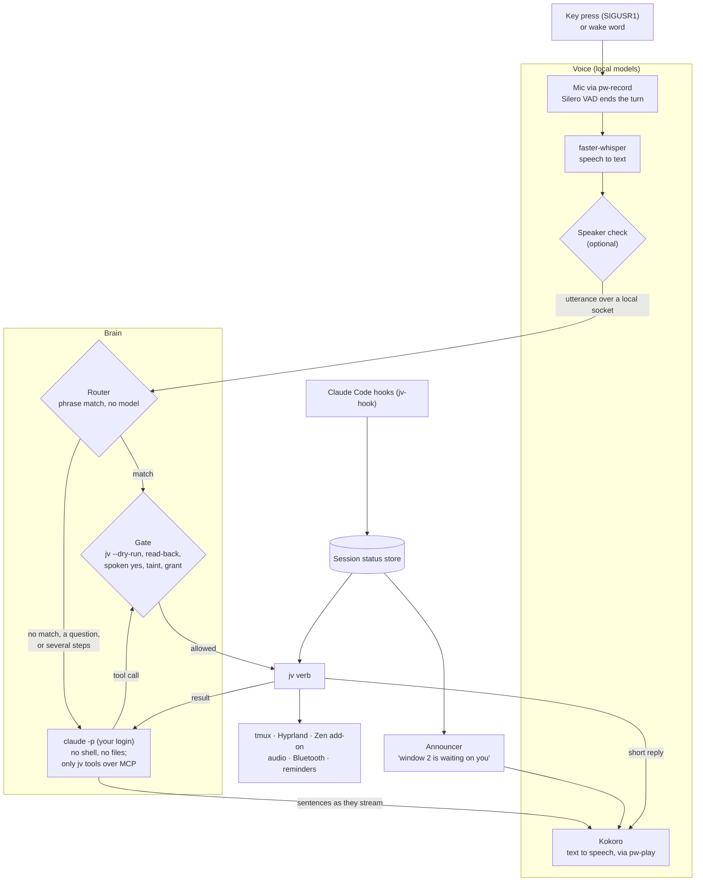

# Architecture

heardback is one systemd user service, `heardbackd`, plus `jv`, a dependency-free command-line tool that does every action. The daemon hears you, decides what you meant, and runs `jv`. Nothing else touches your desktop.

## One turn

1. **Start.** A key bound to `systemctl --user kill -s SIGUSR1 heardback.service`, or the wake word if you have a wake model. The microphone is always open but frames are dropped until then.
2. **Listen.** Silero VAD finds speech; 0.7 seconds of silence ends your turn. Media pauses while it listens.
3. **Transcribe.** faster-whisper on the GPU (about 0.4 s for a short command), or a smaller English model on the CPU. A filter drops the phantom phrases Whisper hears in silence.
4. **Route.** The router matches your words against the phrase templates each verb declares in `jv list`. A confident match runs on the fast path with no model. Anything else, including questions and multi-step requests, goes to Claude.
5. **Claude.** One long-lived `claude -p` process, started at boot so it is warm. Its only tools are `jv` verbs served by a small MCP server. It resets after 10 idle minutes or when you say "new topic".
6. **Gate.** Every action, from either path, goes through the gate described in [safety.md](safety.md). Read verbs run straight away; the rest are dry-run first, and some need a spoken yes.
7. **Speak.** Kokoro turns each finished sentence into audio while the next is still being written, so the first words play before Claude is done. Press the key again to cut it off.

Typical time from the end of your speech to the first word back, measured on the author's machine with a GPU: a median of 0.9 s on the fast path (206 turns) and 4.4 s through Claude (402 turns).

## Pieces

| Piece | Where | What |
|---|---|---|
| `heardbackd` | `src/heardback/daemon.py` | Starts voice and brain in one process; systemd watchdog. |
| Voice | `src/heardback/voice/` | Mic, VAD, wake word, speech to text, speaker check, text to speech, dictation. |
| Brain | `src/heardback/brain/` | Router, the Claude process, the gate, the MCP server (`mcp_jv.py`). |
| Status | `src/heardback/status/` | Claude Code hook handler (`jv-hook`), session store, announcer. |
| `jv` | `src/jv/` | Every verb. Standard library only. Exit codes: 0 done, 1 failed, 2 usage, 3 needs a yes, 4 refused. |
| Zen add-on | `extension/` | Browser tabs and media, through native messaging (`zen-host`). Optional. |
| Unit | `systemd/heardback.service` | The user service. |

## Where things live

| Path | What |
|---|---|
| `~/.config/heardback/` | `config.toml`, `voice.toml`, `actions.toml`. See [configuration.md](configuration.md). |
| `~/.local/state/heardback/` | `trace.jsonl` (one line per event, joined by turn id), `brain.log`, session status, reminders. |
| `~/.local/share/heardback/models/` | Downloaded models. |

`heardback-voice trace --last 1` shows the latest turn as a timeline; `--errors` lists failures.
